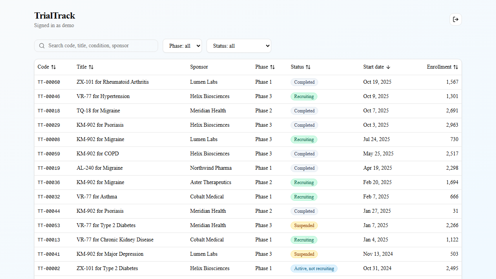
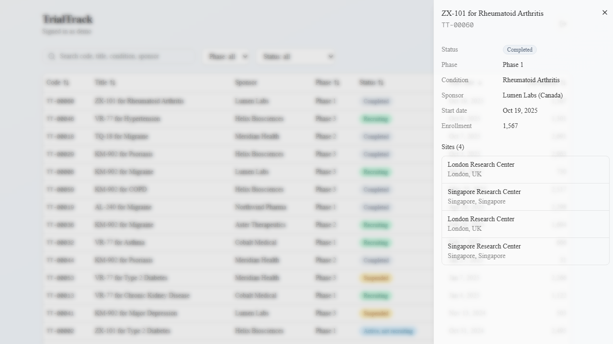
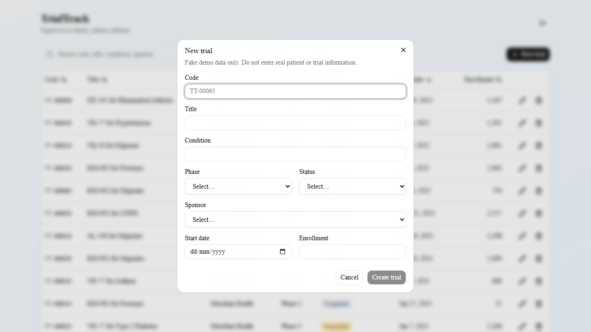
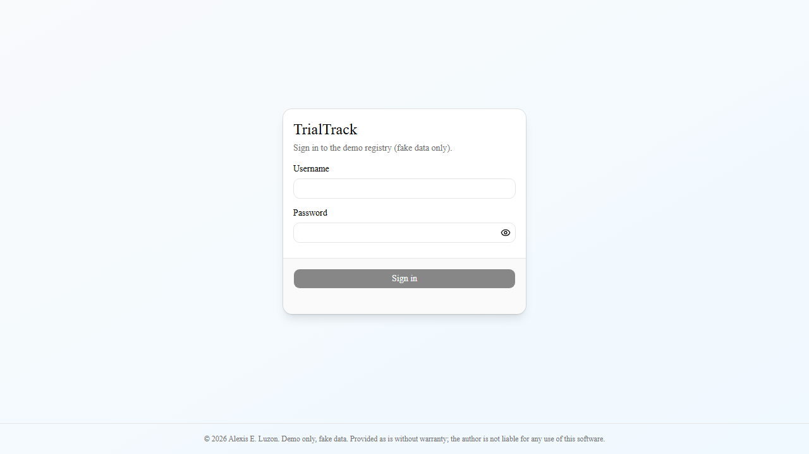
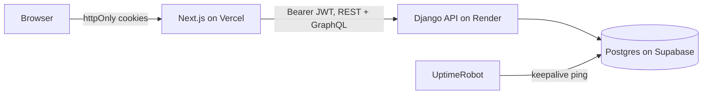

# TrialTrack

A clinical trial registry demo: a data-dense, accessible Next.js front end over a Django API.
**Fake data only. Not for real patient or medical use.**

## Live demo
- App: https://trialtrack-web.vercel.app
- On the sign-in page, click **Try as member** (read-only) or **Try as admin**. No account needed.
- The demo admin can create trials (max 25) and edit or delete only the ones it created; seeded data is read-only.
- First load may take up to a minute while the free API wakes up.



| Detail panel (GraphQL) | Admin form | Sign in |
|---|---|---|
|  |  |  |

## Highlights
- Server-side search, sort, filter and pagination; state lives in the URL (shareable, back/forward works)
- Trial detail panel loaded through GraphQL; staff-only create, edit and delete through REST
- Next.js App Router with Server Components, server actions and `proxy.ts` route protection
- React Hook Form + Zod validation on the client and again on the server
- Responsive, keyboard-friendly UI with skeletons, toasts, tooltips and confirmation dialogs
- API responses validated at runtime with Zod (REST and GraphQL), with types inferred from the schemas

## Architecture

The browser never sees a token or talks to Django directly. Next.js acts as a backend-for-frontend.

## Security
- JWTs in httpOnly, SameSite=Lax, Secure cookies; silent refresh in `proxy.ts`
- Same-origin checks on mutating BFF routes; no CORS surface
- Allowlisted filter and sort inputs; ORM only, no raw SQL
- Django: role-based permissions, throttling, HTTPS and HSTS in production
- GraphQL: auth required, depth, alias and token limits, introspection off in production
- Postgres: row-level security on public tables so the public API key can only read one keepalive table

## Accessibility and testing
- Jest (unit), pytest (API and GraphQL), Playwright E2E on Chromium, Firefox and WebKit
- axe-core checks for WCAG 2.1 AA in E2E (automated only; manual screen-reader testing not done)
- GitHub Actions gates merges on lint, typecheck, unit, API and E2E tests; pre-commit hook runs the fast checks

## Stack
- Web: Next.js, React, TypeScript, Tailwind, shadcn/ui, TanStack Query, React Hook Form, Zod
- API: Django, Django REST Framework, Strawberry GraphQL, SimpleJWT
- Data: Postgres (Supabase)
- Hosting: Vercel (web), Render (API)

## Local development
```powershell
# API
cd api
python -m venv .venv
.\.venv\Scripts\Activate.ps1
python -m pip install -r requirements.txt
Copy-Item .env.example .env    # fill in values
python manage.py migrate
python manage.py seed_demo
python manage.py runserver

# Web (new terminal)
cd web
npm ci
Copy-Item .env.example .env.local
npm run dev
```
Sign in as `demo` (member) or `demo_admin` (staff) with the passwords from `api/.env`.

## Tests
```powershell
cd api; python -m pytest          # unit and API tests
cd web; npm test                  # Jest unit tests
cd web; npm run e2e               # Playwright (run from the activated API venv)
```

## Git hooks
```powershell
git config core.hooksPath .githooks
```

## Known limitations
- Logout clears cookies but does not revoke the refresh token
- The login rate limit is keyed by IP, which is shared behind the Vercel proxy
- No audit logging; a real regulated system would need it
- Free-tier cold starts on the API

## Disclaimer
Provided "as is" without warranty of any kind. The author is not liable for any damages arising from its use.

© 2026 Alexis E. Luzon. All rights reserved.